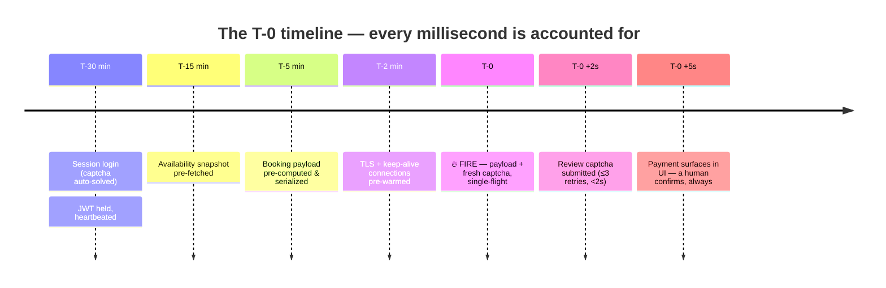
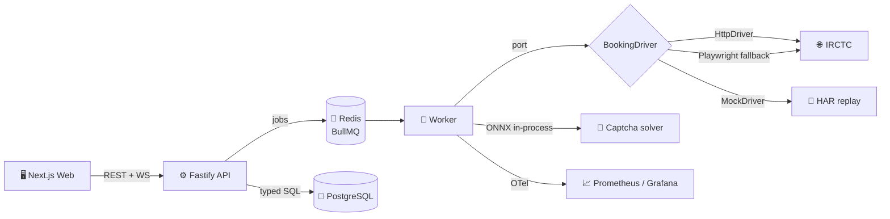

<div align="center">

# 🚄 TatkalPro

**Beat the Tatkal window. Land at the top of the queue.**

A self-hosted, open-source IRCTC Tatkal booking super-app.
Pre-save your journey, and the system fires a millisecond-precise booking
request the instant the window opens.

[](https://github.com/debiddr5777/tatkalpro/actions/workflows/ci.yml)
[](LICENSE)
[](https://www.typescriptlang.org/)
[](https://nodejs.org/)
[]()

*Free forever. Open source. No paywalls. Nothing monetary.*

</div>

---

## ⚡ How it works



## 🏗 Architecture



**Key idea:** IRCTC doesn't expose a client-side queue — queue position is
determined by *when your request arrives at their server*. So TatkalPro
eliminates everything between T-0 and arrival: pre-authenticated sessions,
pre-warmed TLS, pre-computed payloads, and an in-process captcha model.

## 📊 Feature highlights

| | Feature |
|---|---|
| ⏱️ | **Millisecond-precise T-0 firing** — BullMQ delayed jobs + server clock-skew correction |
| 🔐 | **Pre-authenticated sessions** — login 30 min early, JWT heartbeated every 4 min |
| 🧠 | **In-process ONNX captcha solver** — <50 ms per solve (vs ~1–2 s with the classic EasyOCR sidecar) |
| 🛣️ | **Two-driver race** — a typed HTTP driver races an armed Playwright fallback; single-flight lock dedupes |
| 📦 | **Pre-computed payloads** — Zod-validated and serialized once; only the captcha token is injected at T-0 |
| 📈 | **Full observability** — arrival-vs-T-0 histograms, latency breakdowns, captcha accuracy, queue depth in Grafana |
| 🤝 | **Human-in-the-loop payments** — the app never auto-pays; a human always confirms |
| 🧪 | **Offline-first testing** — the entire pipeline runs against recorded HARs in CI |

## 🧰 Stack

| Layer | Choice |
|---|---|
| Language | TypeScript 5 (strict), Node 22, ESM |
| API | Fastify · REST + WebSockets · OpenAPI at `/docs` |
| Jobs | BullMQ on Redis (millisecond-precision delayed jobs) |
| Database | PostgreSQL 16 · Drizzle ORM |
| Frontend | Next.js 15 · Tailwind · TanStack Query · Zustand |
| Captcha | ONNX CNN (onnxruntime-node) · Tesseract.js fallback · human-in-the-loop |
| Observability | OpenTelemetry · Prometheus · Grafana · Loki · pino |
| Dev env | Docker Compose · Turborepo · pnpm workspaces |

## 🚀 Quick start

```bash
cp .env.example .env
# generate secrets:
openssl rand -hex 32   # → ENCRYPTION_KEY
openssl rand -hex 32   # → JWT_SECRET

make db-up      # postgres + redis + prometheus + grafana + loki
pnpm install
make dev        # api + worker + web with hot reload
```

| Service | URL |
|---|---|
| 🖥️ Web | http://localhost:3000 |
| ⚙️ API | http://localhost:4000 · Swagger at `/docs` |
| 📈 Grafana | http://localhost:3001 (admin/admin) |
| 📊 Prometheus | http://localhost:9090 |

## 📁 Repository layout

```
tatkalpro/
├── apps/
│   ├── api/               # Fastify REST + WS gateway
│   ├── worker/            # BullMQ booking orchestrator (the T-0 engine)
│   ├── web/               # Next.js frontend with live countdown
│   └── captcha-solver/    # ONNX inference + harvesting + training
├── packages/
│   ├── core/              # domain: state machine, clock port, error taxonomy
│   ├── contracts/         # Zod schemas shared from DB to UI
│   ├── booking-engine/    # BookingDriver port + Http/Playwright/Mock drivers
│   ├── db/                # Drizzle schema + migrations
│   ├── queue/             # BullMQ queues + retry policy
│   ├── observability/     # OTel, Prometheus metrics, pino
│   └── config/            # Zod-validated env
├── infra/                 # Prometheus + Grafana provisioning
└── docs/                  # ADRs, IRCTC flow reference, runbook
```

## 🧭 Principles

- **Hexagonal architecture** — the domain layer never touches IRCTC, HTTP, or DB code; drivers are swappable ports.
- **Event-driven** — every state transition emits a typed event consumed by WebSockets and metrics.
- **Idempotent & single-flight** — one in-flight booking per journey, enforced by a Redis lock.
- **Typed end to end** — Zod contracts are the single source of truth; `any` is banned.
- **Time is a dependency** — all clock logic goes through an injectable `Clock` port.
- **Fail fast** — invalid config crashes the process at startup, never at T-0.

## ⚠️ Ethics & responsible use

> This tool is for **personal use only**, automating **your own** IRCTC account
> with **your own** credentials. IRCTC's terms of service prohibit automated
> booking — you are responsible for your own compliance. TatkalPro hard-limits
> to 4 passengers per PNR (IRCTC Tatkal rule), one booking per session at a
> time, and respectful rate limits. **Payments are never auto-completed** — a
> human always confirms the money movement. Don't use it as a scalper, bulk
> agent, or reseller tool.

## 🗺️ Roadmap

- [x] Monorepo scaffold, domain layer, contracts, state machine
- [ ] `HttpDriver` implemented from captured HARs (`pnpm record:irctc`)
- [ ] Playwright driver + HAR recorder CLI
- [ ] Captcha model training pipeline + labeling UI
- [ ] Full booking orchestrator with T-0 timeline
- [ ] Grafana dashboards + alerting
- [ ] Load tests (k6, T-0 spike simulation)

## 🤝 Contributing

PRs are welcome. Read `docs/ADR/` for the architectural decisions, and follow
conventional commits (`feat:`, `fix:`, `chore:`). Every change must pass
`pnpm lint && pnpm typecheck && pnpm test`.

## 📄 License

[MIT](LICENSE) — free forever, for everyone.
